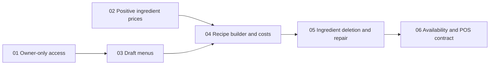

# US-03 local specification and tickets

Status: implemented locally; final code review in progress. This is the active tracker for US-03.

- [Approved specification](spec.md)
- All six tickets are in review after implementation and validation. Begin a ticket only when its
  declared blockers are complete.
- The approved testing interfaces are owner-facing Django requests using a real
  test database, plus the shared menu read interface consumed by POS/reporting.
- Implementation is complete; 92 tests pass (one optional browser test skipped), the separate real-browser check passes, and total coverage is 93.66%.

## Tickets and blocking edges

| Ticket | What it delivers | Blocked by |
| --- | --- | --- |
| [01 — Owner-only access](issues/01-owner-only-access.md) | Existing business screens admit restaurant owners and safely reject other access. | None |
| [02 — Positive ingredient prices](issues/02-positive-ingredient-prices.md) | Inventory screens and integrity rules require positive unit prices while allowing zero stock. | None |
| [03 — Draft menu management](issues/03-draft-menu-management.md) | Owners create/edit private inactive menus with unique normalized names and conflicting-save protection. | 01 |
| [04 — Recipe builder and costs](issues/04-recipe-builder-and-costs.md) | Owners maintain per-serving ingredient quantities, see current costs and protect referenced units. | 02, 03 |
| [05 — Deleted ingredient repair](issues/05-deleted-ingredient-repair.md) | Ingredient deletion deactivates affected menus and leaves visible missing rows that owners repair. | 04 |
| [06 — Availability and POS contract](issues/06-menu-availability-and-pos-contract.md) | Owners explicitly activate valid menus and expose consistent quantities/cost/sellability to consumers. | 05 |

Tickets 01 and 02 can start independently. Blocking edges list only direct
prerequisites; transitive dependencies are not repeated. Each ticket delivers
working owner-visible behavior with its own validation, integrity rules and tests.

## Local-only instruction

Do not publish these files as GitHub issues or change external tracker metadata.
The user selected local files only after the earlier publication. The generated
GitHub spec and tickets (9-15) were closed on the user's explicit request. The
original US-03 parent (4) remains open and unchanged. Further external actions
require new user authorization.
