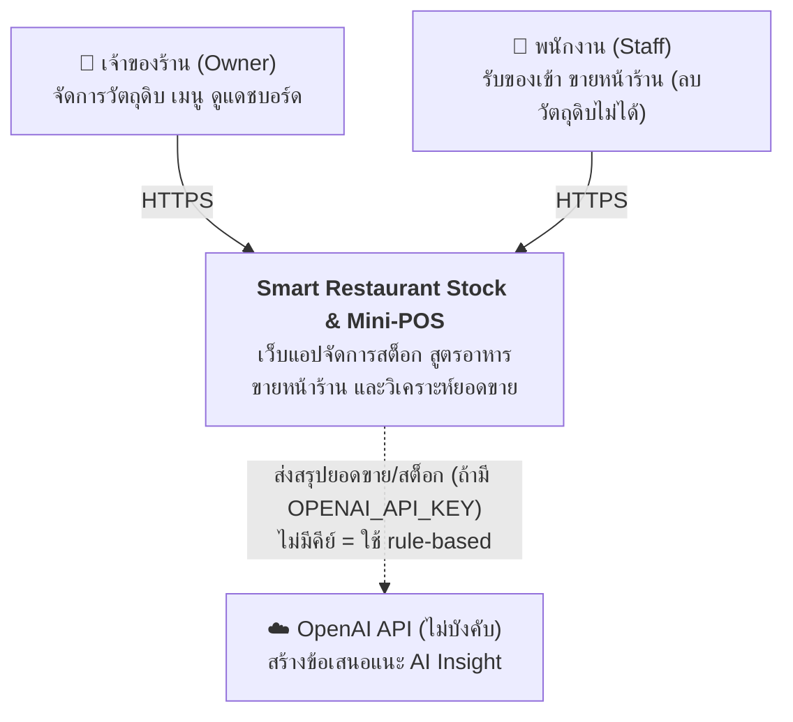
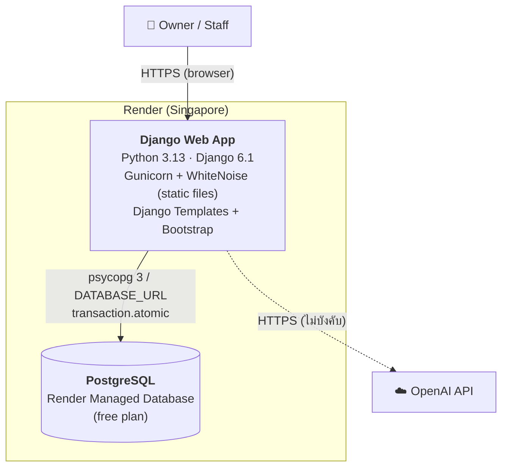
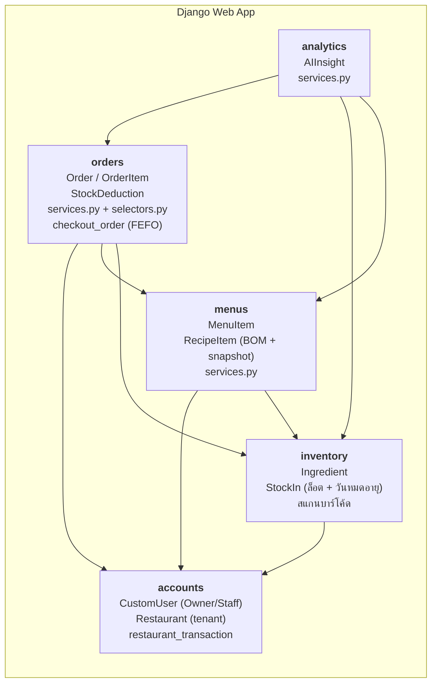

# C4 Architecture — Smart Restaurant Stock & Mini-POS

แผนภาพสถาปัตยกรรมตามโมเดล C4 (Level 1 Context, Level 2 Container, Level 3 Component)
ทุกแผนภาพเป็น Mermaid แสดงผลบน GitHub ได้โดยตรง

## Level 1 — System Context

- ผู้ใช้ทุกคนสังกัดร้านเดียว (multi-tenant) ข้อมูลแยกต่อร้านด้วย `restaurant` FK
- OpenAI เป็นระบบภายนอกเพียงตัวเดียว ถ้าไม่ตั้ง `OPENAI_API_KEY` ระบบ fallback เป็นกฎ (`provider='rules'`)

## Level 2 — Container

| Container | เทคโนโลยี | หน้าที่ |
|---|---|---|
| Django Web App | Django 6.1, Gunicorn, WhiteNoise, Bootstrap | รับ request, render หน้าเว็บ, business logic ทั้งหมด |
| PostgreSQL | Render Managed PostgreSQL | เก็บข้อมูลทุกร้าน, ล็อกแถวร้านตอนขายเพื่อกัน race condition |

การตั้งค่า deploy อยู่ที่ [`render.yaml`](../../render.yaml) และ [`build.sh`](../../build.sh)
(`DEBUG=False`, `SECRET_KEY` สร้างโดย Render, `DATABASE_URL` มาจาก managed DB)

## Level 3 — Component (Django apps)

ลูกศรคือทิศทางการ import ในโค้ดจริง (ผู้ใช้ → ผู้ถูกใช้) ตรวจด้วย grep บน `import` ข้าม app
ลำดับชั้นจากล่างขึ้นบนคือ `accounts` → `inventory` → `menus` → `orders` → `analytics`
ไม่มีการ import ย้อนกลับในโค้ด production (ไม่นับโฟลเดอร์ test)

> หมายเหตุ: มี import ย้อนทิศเพียงจุดเดียวคือ `accounts/test_deployment_bootstrap.py`
> ที่ import `orders.models.Order` เป็นไฟล์ test ไม่กระทบตอนรันระบบ
> เรายังไม่มี test เฉพาะสำหรับตรวจ circular import
> (`manage.py check` และชุด test ผ่านทั้งหมด)

### ชั้นภายในแต่ละ app (ตาม ADR 001)

`View (HTTP)` → `Service (เขียน/ธุรกรรม)` → `Selector (อ่าน)` → `Model`

- `orders`, `menus`, `analytics` ทำตามรูปแบบนี้แล้ว
- `inventory/views.py` ยังเป็น Fat View (339 บรรทัด) บันทึกเป็นหนี้ทางเทคนิค TD-01
- Transaction: `checkout_order` ทำงานภายใน `restaurant_transaction` (`accounts/transactions.py`)
  ซึ่งใช้ `transaction.atomic()` ร่วมกับการล็อกแถวร้าน

เอกสารที่เกี่ยวข้อง: [ADR 001 Service Layer + Concurrency](../adr/001-service-layer-and-concurrency.md),
[ADR 002 FEFO](../adr/002-fefo-lot-allocation.md), [ERD](erd.md)
