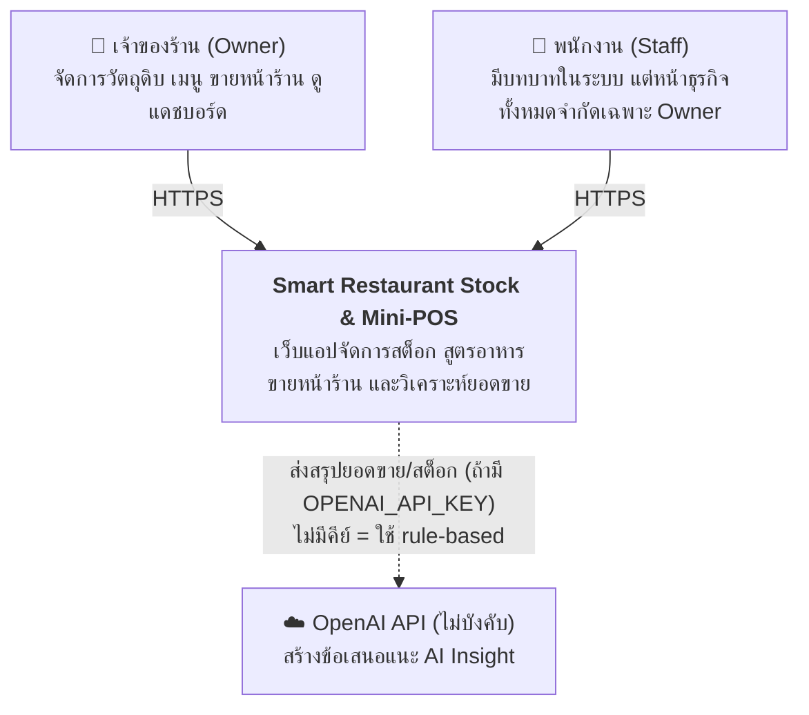
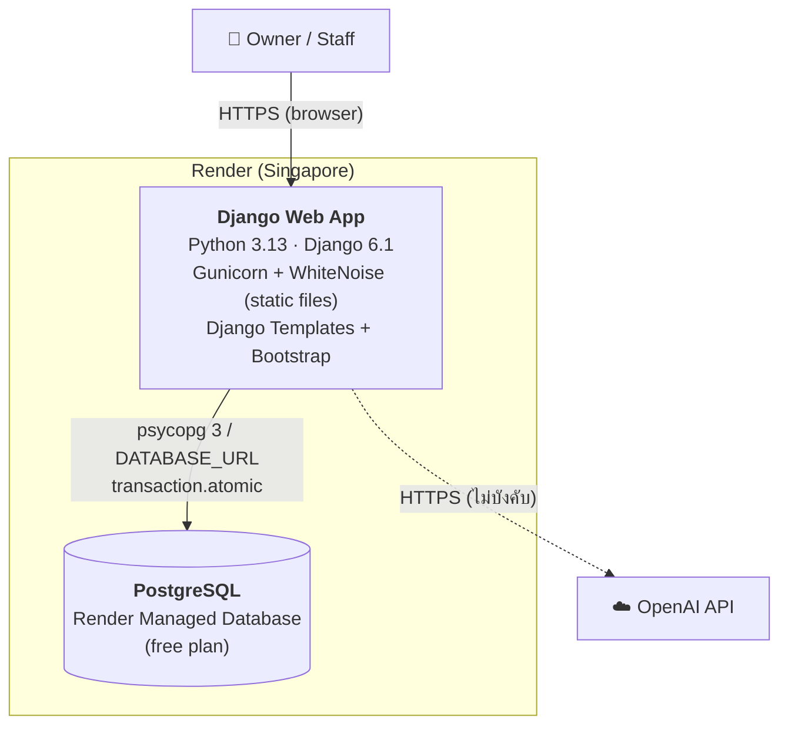
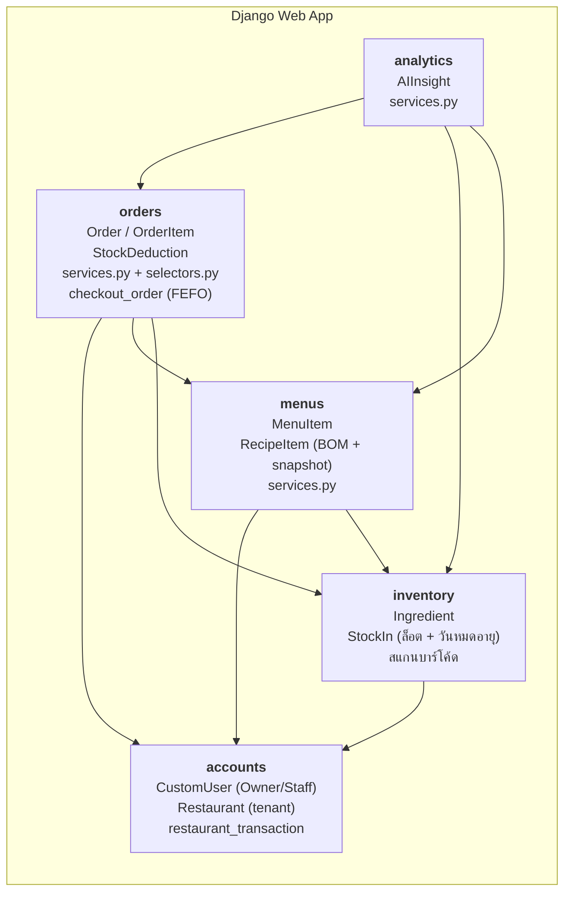
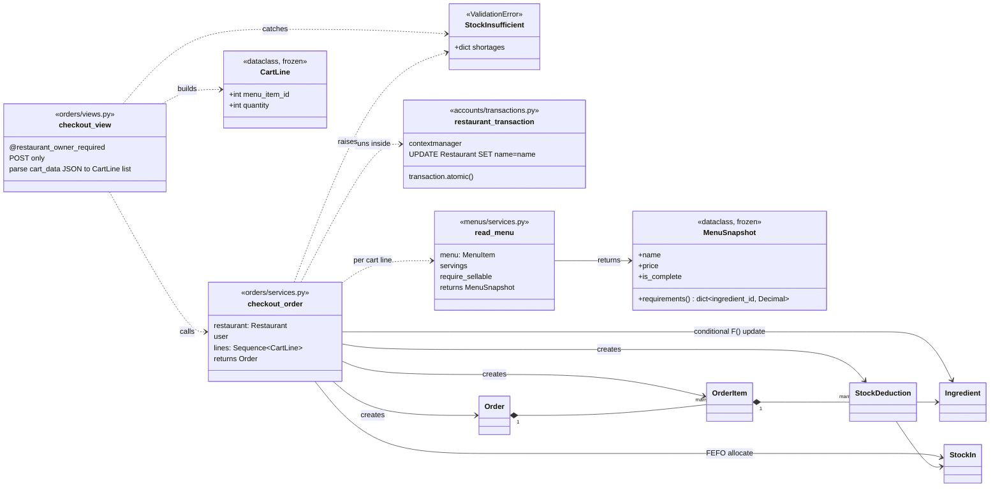
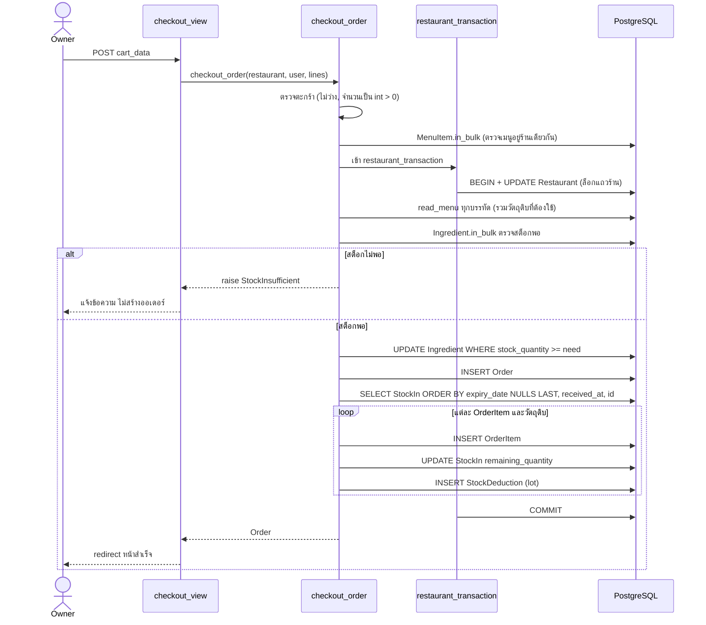

# C4 Architecture — Smart Restaurant Stock & Mini-POS

แผนภาพสถาปัตยกรรมตามโมเดล C4 (Level 1 Context, Level 2 Container, Level 3 Component)
ทุกแผนภาพเป็น Mermaid แสดงผลบน GitHub ได้โดยตรง

## Level 1 — System Context

- ผู้ใช้ทุกคนสังกัดร้านเดียว (multi-tenant) ข้อมูลแยกต่อร้านด้วย `restaurant` FK
- สิทธิ์ตามโค้ดปัจจุบัน: view ของ inventory, menus, orders (POS) และ analytics ใช้ `@restaurant_owner_required`
  ผู้ใช้ role `staff` จึงเข้าหน้าเหล่านี้ไม่ได้ (ได้ `PermissionDenied`) ยังไม่มีหน้าที่เปิดให้ Staff ใช้งาน
- OpenAI เป็นระบบภายนอกเพียงตัวเดียว ถ้าไม่ตั้ง `OPENAI_API_KEY` ระบบ fallback เป็นกฎ (`provider='rules'`)

## Level 2 — Container

| Container | เทคโนโลยี | หน้าที่ |
|---|---|---|
| Django Web App | Django 6.1, Gunicorn, WhiteNoise, Bootstrap | รับ request, render หน้าเว็บ, business logic ทั้งหมด |
| PostgreSQL | Render Managed PostgreSQL | เก็บข้อมูลทุกร้าน, ล็อกแถวร้านตอนขายเพื่อกัน race condition |

การตั้งค่า deploy อยู่ที่ [`render.yaml`](../../render.yaml) และ [`build.sh`](../../build.sh)
(`DEBUG=False`, `SECRET_KEY` สร้างโดย Render, `DATABASE_URL` มาจาก managed DB)

## Level 3 — Component (Django apps)

ลูกศรคือทิศทางการ import ในโค้ดจริง (ผู้ใช้ → ผู้ถูกใช้) ตรวจด้วย grep บน `import` ข้าม app
ลำดับชั้นจากล่างขึ้นบนคือ `accounts` → `inventory` → `menus` → `orders` → `analytics`
ไม่มีการ import ย้อนกลับในโค้ด production (ไม่นับโฟลเดอร์ test)

> หมายเหตุ: มี import ย้อนทิศเพียงจุดเดียวคือ `accounts/test_deployment_bootstrap.py`
> ที่ import `orders.models.Order` เป็นไฟล์ test ไม่กระทบตอนรันระบบ
> เรายังไม่มี test เฉพาะสำหรับตรวจ circular import
> (`manage.py check` และชุด test ผ่านทั้งหมด)

### ชั้นภายในแต่ละ app (ตาม ADR 001)

`View (HTTP)` → `Service (เขียน/ธุรกรรม)` → `Selector (อ่าน)` → `Model`

- `orders`, `menus`, `analytics`, `inventory` ทำตามรูปแบบนี้แล้ว
- `inventory` เดิมเป็น Fat View (`views.py` 339 บรรทัด, หนี้ TD-01) ตอนนี้แยกเป็น
  `services.py` (`add_stock`, `create_ingredient`), `selectors.py` (ค้นหา สรุปสถิติ ล็อต)
  และ `views.py` ที่เหลือเฉพาะงาน HTTP (235 บรรทัด)
- Transaction: `checkout_order` ทำงานภายใน `restaurant_transaction` (`accounts/transactions.py`)
  ซึ่งใช้ `transaction.atomic()` ร่วมกับการล็อกแถวร้าน

## Level 4 — Code (Mini-POS checkout)

เลือกเจาะเฉพาะ use case ที่สำคัญที่สุดคือ US-04 ขายแล้วตัดสต็อกแบบ FEFO
(ส่วนอื่นของระบบไม่ได้วาดระดับนี้) ทุกชื่อ class/function ตรงกับโค้ดที่ `main`

### Class diagram

### ลำดับการทำงานของ `checkout_order`

จุดที่เก็บเป็นหลักฐานอ้างอิงตอนตอบคำถาม:

- **Atomic:** ทั้งหมดอยู่ใน `restaurant_transaction` (ที่ใช้ `transaction.atomic()` ข้างใน) ถ้า exception เกิดกลางทาง ข้อมูลถูก rollback
- **กันขายพร้อมกัน:** ล็อกแถวร้านบน PostgreSQL ทำให้เช็คเอาต์ของร้านเดียวกันเรียงทีละรายการ
  และ `UPDATE ... WHERE stock_quantity >= need` เป็นด่านที่สอง (ถ้าอัปเดตไม่โดนแถวจะ raise `StockInsufficient`)
- **FEFO:** เรียงล็อตตาม `expiry_date` น้อยไปมาก ล็อตที่ไม่มีวันหมดอายุไปท้ายสุด (`nulls_last=True`)
- **ของเก่าไม่มีล็อต:** ถ้าล็อตหมดแต่ยังต้องตัด จะบันทึก `StockDeduction` ที่ `lot=None`
- **อ่านเมนูและสูตรด้วย `select_related`** ใน `read_menu` (ไม่ได้พิสูจน์ด้วย `assertNumQueries`)

เอกสารที่เกี่ยวข้อง: [ADR 001 Service Layer + Concurrency](../adr/001-service-layer-and-concurrency.md),
[ADR 002 FEFO](../adr/002-fefo-lot-allocation.md), [ERD](erd.md)
