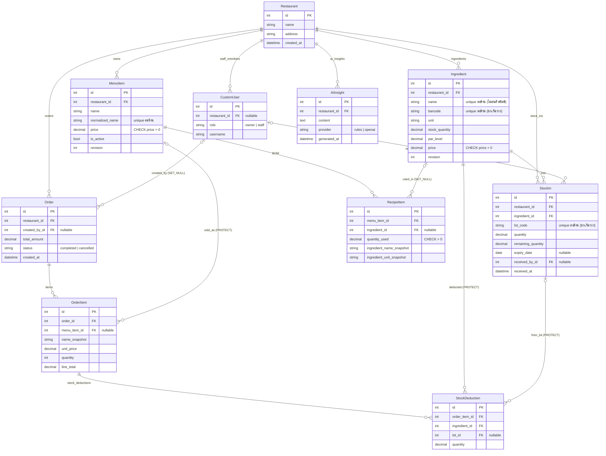

# ERD — Smart Restaurant Stock & Mini-POS

สร้างจาก `models.py` ของ 5 apps (`accounts`, `inventory`, `menus`, `orders`, `analytics`)
ที่ `main` @ `7419efe` ตารางที่ Django สร้างให้เอง (`auth_group`, `django_session` ฯลฯ) ไม่ได้ใส่ไว้

## จุดออกแบบที่ควรรู้

| จุด | เหตุผล |
|---|---|
| ทุกตารางธุรกิจมี `restaurant_id` (ยกเว้นลูกที่ผ่านพ่อ เช่น `OrderItem`, `RecipeItem`, `StockDeduction`) | แยกข้อมูลต่อร้าน (multi-tenant) |
| `OrderItem.name_snapshot`, `unit_price` และ `RecipeItem.ingredient_*_snapshot` | เก็บค่า ณ ตอนขาย/ตอนทำสูตร ข้อมูลเก่าไม่เพี้ยนเมื่อแก้ชื่อหรือราคาทีหลัง |
| `StockDeduction` ผูกกับ `StockIn` (ล็อต) | ตรวจย้อนได้ว่าขายแต่ละจานตัดจากล็อตไหน (FEFO ตาม ADR 002) |
| `RecipeItem.ingredient` เป็น `SET_NULL` | ลบวัตถุดิบได้โดยสูตรเก่ายังเก็บชื่อจาก snapshot |
| `OrderItem.menu_item`, `StockDeduction.*` เป็น `PROTECT` | กันลบเมนู/วัตถุดิบ/ล็อตที่มีประวัติขายอ้างอิงอยู่ |
| `Ingredient.revision`, `MenuItem.revision` | optimistic locking กันแก้ทับกัน |
| `Ingredient.stock_quantity` | ยอดรวมของวัตถุดิบ ส่วนวันหมดอายุเก็บรายล็อตใน `StockIn` |

เอกสารที่เกี่ยวข้อง: [C4](c4.md), [ADR 002 FEFO](../adr/002-fefo-lot-allocation.md)
