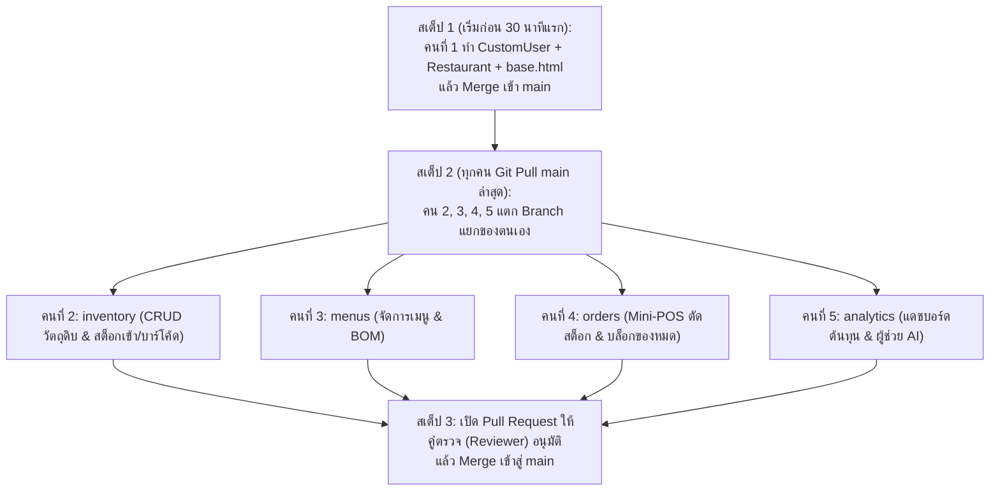

# แผนการแบ่งงานโครงงาน (Team Task Allocation & Sprint 1 Plan)
## วิชา CN331 Software Engineering | กลุ่ม 5 คน
**ชื่อกลุ่ม:** หมูแองกี้เบิ้ด  
**Repository:** `Restaurant-management/CN331-Restaurant-management`

---

## 1. ตารางภาพรวมการแบ่งงาน (Overview Matrix)

| สมาชิก | บทบาทและความรับผิดชอบหลัก | Use Case | Django App | Story Points | Git Feature Branch | ผู้ตรวจ PR (Reviewer) |
| :---: | :--- | :---: | :---: | :---: | :--- | :---: |
| **คนที่ 1** | **Auth, Multi-Tenant & Layout** *(Scrum Master Sprint 1)* | `UC-01` | `accounts` | 5 | `feature/issue-01-auth-tenant` | คนที่ 2 |
| **คนที่ 2** | **ระบบคลังวัตถุดิบ & รับของเข้า (Manual + บาร์โค้ด)** | `UC-02` | `inventory` | 5 | `feature/issue-02-ingredient-crud` | คนที่ 3 |
| **คนที่ 3** | **ระบบจัดการเมนูอาหาร & ผูกสูตร (BOM Builder)** | `UC-03` | `menus` | 5 | `feature/issue-03-menu-recipe` | คนที่ 4 |
| **คนที่ 4** | **ระบบ Mini-POS ตัดสต็อก & เตือนของหมดล็อกการสั่ง** | `UC-04` | `orders` | 5 | `feature/issue-04-pos-deduction` | คนที่ 5 |
| **คนที่ 5** | **ระบบแดชบอร์ดวิเคราะห์สถิติ & สรุปข้อมูลผสาน AI** | `UC-05` | `analytics` | 5 | `feature/issue-05-ai-analytics` | คนที่ 1 |

> **รวม Story Points ใน Sprint 1:** 25 แต้ม (เฉลี่ยคนละ 5 แต้ม เหมาะสมกับ Capacity ของทีม เพื่อหลีกเลี่ยงงานล้นมือ)

---

## 2. รายละเอียดงานรายบุคคล (Detailed Member Breakdown)

### คนที่ 1: Scrum Master & Core Foundation (Auth, Tenant & Layout)
* **User Story:** `US-01`: ในฐานะเจ้าของร้าน ฉันต้องการสมัครและเข้าสู่ระบบเพื่อจัดการร้านของตนเอง
* **Use Case ID:** `UC-01: Auth & Tenant`
* **งานฝั่ง Agile (Scrum Master):**
  - [ ] สร้างบอร์ด Kanban บน **GitHub Projects** (คอลัมน์: *Backlog -> Sprint 1 -> In Progress -> Review -> Done*)
  - [ ] นำ User Stories แปลงเป็น GitHub Issues พร้อมกำหนด Label และแต้ม Story Points
  - [ ] ตั้งค่า Branch Protection บน branch `main` (Require PR + 1 Reviewer Approve)
* **งานฝั่งเทคนิค (Django Development):**
  - [ ] สร้าง App `accounts` และลงทะเบียนใน `INSTALLED_APPS`
  - [ ] สร้างโมเดล `CustomUser(AbstractUser)` และ `Restaurant`
  - [ ] กำหนด `AUTH_USER_MODEL = 'accounts.CustomUser'` ใน `settings.py` (ก่อน migrate ครั้งแรก)
  - [ ] สร้างฟอร์ม `CustomUserCreationForm`, `AuthenticationForm` และ `RestaurantForm`
  - [ ] เขียน Views: `register_view`, `login_view`, `logout_view` (บังคับ `@require_POST`)
  - [ ] สร้าง `templates/base.html` (โหลด Bootstrap 5, Flash Message alerts) และ `templates/navbar.html`
* **ไฟล์ที่รับผิดชอบ:**
  - `accounts/models.py`
  - `accounts/forms.py`
  - `accounts/views.py`
  - `accounts/urls.py`
  - `templates/base.html`, `templates/navbar.html`, `templates/accounts/login.html`, `templates/accounts/register.html`

---

### คนที่ 2: Inventory & Inbound Stock Lead (Manual & Barcode)
* **User Story:** `US-02`: ในฐานะเจ้าของร้าน ฉันต้องการเพิ่ม/จัดการวัตถุดิบ บันทึกรับของเข้าคลังทั้งแบบกรอกจำนวนเองและสแกนบาร์โค้ด
* **Use Case ID:** `UC-02: Manage Ingredient & Inbound Stock (Manual & Barcode)`
* **เป้าหมายสำคัญ:** ส่งมอบ **"หน้าจอ CRUD แรก + ระบบรับของเข้า"** สำหรับตรวจรับงาน Sprint 1 (10% Deliverable)
* **งานฝั่งเทคนิค (Django Development):**
  - [ ] สร้าง App `inventory` และลงทะเบียนใน `INSTALLED_APPS`
  - [ ] สร้างโมเดล `IngredientCategory` และ `Ingredient` (เชื่อม FK กับ `Restaurant`)
    - ฟิลด์: `name`, `category`, `unit`, `cost_per_unit`, `current_stock`, `par_level`, `expiry_date`, `barcode` (Char/Optional)
  - [ ] สร้าง `IngredientModelForm` และฟอร์มรับของเข้า ตกแต่ง UI ด้วย Bootstrap 5
  - [ ] เขียน Field-level Validation (`clean_current_stock()`, `clean_cost_per_unit()` ห้ามติดลบ)
  - [ ] เขียน Views:
    - `ingredient_list`: แสดงตารางวัตถุดิบทั้งหมด (กรองเฉพาะร้านที่ล็อกอิน: `restaurant=request.user.restaurant`)
    - `ingredient_create`, `ingredient_update`, `ingredient_delete`
    - `stock_in_manual_view`: ป้อนตัวเลขรับของเข้า เพิ่มยอด `current_stock` ทันที
    - `stock_in_barcode_view`: สแกนบาร์โค้ด (หรือกรอกรหัสบาร์โค้ด) เพื่อค้นหาวัตถุดิบและเติมสต็อกอัตโนมัติ
  - [ ] ใส่ `@login_required` ทุก View และส่งข้อความ Flash Message ด้วย `messages.success()`
* **ไฟล์ที่รับผิดชอบ:**
  - `inventory/models.py`
  - `inventory/forms.py`
  - `inventory/views.py`
  - `inventory/urls.py`
  - `templates/inventory/ingredient_list.html`, `templates/inventory/ingredient_form.html`, `templates/inventory/stock_in.html`

---

### คนที่ 3: Menu & Recipe/BOM Builder Lead
* **User Story:** `US-03`: ในฐานะเจ้าของร้าน ฉันต้องการสร้างเมนูอาหารและผูกสูตร (Recipe) กับวัตถุดิบที่ใช้
* **Use Case ID:** `UC-03: Recipe / BOM Builder`
* **งานฝั่งเทคนิค (Django Development):**
  - [ ] สร้าง App `menus` และลงทะเบียนใน `INSTALLED_APPS`
  - [ ] สร้างโมเดล:
    - `MenuItem`: `restaurant` (FK), `name`, `price`, `is_active`
    - `RecipeItem`: `menu_item` (FK), `ingredient` (FK), `quantity_used`
  - [ ] สร้าง `MenuItemForm` และ `RecipeItemForm`
  - [ ] เขียน Views:
    - `menu_list`: แสดงเมนูอาหารและต้นทุนคำนวณอัตโนมัติ
    - `menu_create`: เพิ่มเมนูใหม่
    - `recipe_builder_view`: หน้าจอผูกวัตถุดิบเข้ากับเมนู (เลือก Ingredient และระบุปริมาณที่ใช้)
  - [ ] เขียน Logic คำนวณ **"ต้นทุนวัตถุดิบต่อจาน"** (ผลรวมของ `Ingredient.cost_per_unit * RecipeItem.quantity_used`)
  - [ ] ทำ Data Isolation Check: ป้องกันการดึงวัตถุดิบข้ามร้านมาใส่ในสูตร
* **ไฟล์ที่รับผิดชอบ:**
  - `menus/models.py`
  - `menus/forms.py`
  - `menus/views.py`
  - `menus/urls.py`
  - `templates/menus/menu_list.html`, `templates/menus/menu_form.html`, `templates/menus/recipe_builder.html`

---

### คนที่ 4: Mini-POS & Smart Out-of-Stock Guard Lead
* **User Story:** `US-04`: ในฐานะพนักงาน ฉันต้องการบันทึกออเดอร์ขายผ่านหน้า Mini-POS โดยระบบตัดสต็อกอัตโนมัติ และแสดงการแจ้งเตือนพร้อมล็อกไม่ให้สั่งอาหารหากวัตถุดิบหมด
* **Use Case ID:** `UC-04: Record Sale & Out-of-Stock Guard (Mini-POS)`
* **งานฝั่งเทคนิค (Django Development):**
  - [ ] สร้าง App `orders` และลงทะเบียนใน `INSTALLED_APPS`
  - [ ] สร้างโมเดล:
    - `Order`: `restaurant` (FK), `created_at`, `total_amount`, `status`
    - `OrderItem`: `order` (FK), `menu_item` (FK), `quantity`, `price`
  - [ ] พัฒนา **Real-Time Out-of-Stock Guard (ระบบเตือนของหมด & ล็อกปุ่มสั่ง)**:
    - ตรวจสอบปริมาณวัตถุดิบในสูตร (`RecipeItem`) เทียบกับ `Ingredient.current_stock`
    - เมนูใดที่วัตถุดิบไม่พอ ให้แสดง Badge สีแดง `[วัตถุดิบหมด / Sold Out]` บนการ์ดเมนู และสั่ง `disabled` ปุ่มเพิ่มลงตะกร้า/ปุ่มสั่งซื้อ (กดสั่งไม่ได้)
  - [ ] พัฒนา **Stock Deduction Engine**:
    - เมื่อยืนยันการขาย ให้ตัดยอด `Ingredient.current_stock` ด้วยคำสั่ง `F('current_stock') - used`
    - ครอบด้วย `transaction.atomic()` เพื่อป้องกัน Race Condition
  - [ ] ออกแบบหน้าจอ UI `pos.html` และหน้ายืนยันการขายสำเร็จ `order_success.html`
* **ไฟล์ที่รับผิดชอบ:**
  - `orders/models.py`
  - `orders/views.py`
  - `orders/urls.py`
  - `templates/orders/pos.html`, `templates/orders/order_success.html`

---

### คนที่ 5: AI-Powered Analytics & Dashboard Lead
* **User Story:** `US-05`: ในฐานะเจ้าของร้าน ฉันต้องการดูแดชบอร์ดสรุปต้นทุน ยอดขาย และคำแนะนำอัจฉริยะจาก AI สำหรับวางแผนสั่งซื้อวัตถุดิบและควบคุมต้นทุน
* **Use Case ID:** `UC-05: AI-Powered Stock & Sales Analytics`
* **งานฝั่งเทคนิค (Django Development):**
  - [ ] สร้าง App `analytics` และลงทะเบียนใน `INSTALLED_APPS`
  - [ ] พัฒนา **Cost & Margin Engine**:
    - ดึงข้อมูลจาก `MenuItem` และ `RecipeItem` คำนวณต้นทุนวัตถุดิบต่อจาน (Cost per Dish) และกำไรขั้นต้น
  - [ ] พัฒนา **AI Integration Service (เช่น Google Gemini API / OpenAI)**:
    - ส่งสถิติการขายและความเคลื่อนไหวสต็อกเข้า Prompt ของ AI
    - **Smart Restock Suggestions**: AI วิเคราะห์แนวโน้มและแนะนำการสั่งซื้อวัตถุดิบล่วงหน้า ป้องกันของหมด
    - **Cost & Waste Advisory**: AI แนะนำการจัดการวัตถุดิบที่ใช้ช้าใกล้หมดอายุ และแนะนำการตั้งราคา/ปรับสัดส่วนสูตร
  - [ ] พัฒนา **Analytics Dashboard**:
    - แสดง Card สรุปยอด: มูลค่าสต็อก, ยอดขาย, เมนูทำกำไรสูงสุด
    - แสดงกล่องข้อความ **"AI Smart Insights"** แนะนำเจ้าของร้าน
    - แสดงตารางต้นทุนแยกตามเมนูและรายงานความเคลื่อนไหวสต็อก
* **ไฟล์ที่รับผิดชอบ:**
  - `analytics/models.py`
  - `analytics/services.py` (ระบบเชื่อมต่อ AI API)
  - `analytics/views.py`
  - `analytics/urls.py`
  - `templates/analytics/dashboard.html`

---

## 3. การหมุนเวียนตำแหน่ง Scrum Master (3 Sprints)

เนื่องจากทีมมีสมาชิก 5 คน แต่มี 3 Sprints จึงสามารถจัดสรรบทบาทผู้นำ (Scrum Master) และผู้ช่วยตามแต่ละรอบได้อย่างลงตัว ดังนี้:

| Sprint | ระยะเวลา | Scrum Master ประจำรอบ | ภารกิจหลักของ Scrum Master ประจำ Sprint |
| :---: | :---: | :---: | :--- |
| **Sprint 1** | สัปดาห์ 6–7 | **คนที่ 1** (ร่วมกับ **คนที่ 2**) | นำประชุม Planning Poker, คุมบอร์ด GitHub, ร่าง DoR/DoD, ตรวจรับ Sprint 1 Review |
| **Sprint 2** | สัปดาห์ 9–11 | **คนที่ 2** หรือ **คนที่ 3** | คุมกระบวนการเขียน Unit Tests (>80% coverage), ตรวจสอบ CI Pipeline, จัด Retrospective 1 |
| **Sprint 3** | สัปดาห์ 12–14 | **คนที่ 4** หรือ **คนที่ 5** | คุมการตรวจสอบ OWASP Security, การ Deploy ขึ้น Cloud และเตรียม Live Demo Script รอบ Final |

---

## 4. ข้อตกลงทีม (Definition of Ready & Done)

### Definition of Ready (DoR) — เกณฑ์ก่อนดึงงานเข้า Sprint
- [x] เขียนในรูปแบบ User Story สมบูรณ์ (*As a..., I want to..., So that...*)
- [x] มี Acceptance Criteria ระบุชัดเจนอย่างน้อย 3 ข้อ
- [x] มี Mockup UI หรือระบุฟิลด์ของ Data Model คร่าวๆ
- [x] ประเมินขนาดงานร่วมกันผ่าน Planning Poker (1, 2, 3, 5, 8 แต้ม)
- [x] ไม่มี Dependency ภายนอกที่ยังค้างอยู่

### Definition of Done (DoD) — เกณฑ์ชิ้นงานเสร็จสมบูรณ์ 100%
- [x] โค้ดเขียนตามมาตรฐาน PEP 8 มี Docstring ระบุรหัส `[UC-xx]` ทุก View
- [x] ผ่าน Acceptance Criteria ครบถ้วน
- [x] มี `` ทุกฟอร์ม และมี `@login_required` ป้องกันเส้นทาง
- [x] สร้าง Pull Request (PR) และผ่านการตรวจ **Peer Code Review อย่างน้อย 1 คน**
- [x] มีข้อความปิด Issue อัตโนมัติ เช่น `Closes #12` ในคำอธิบายของ PR
- [x] รวมโค้ดเข้าสู่ branch `main` โดยไม่มี Merge Conflict

---

## 5. ลำดับขั้นตอนการปฏิบัติงานเพื่อไม่ให้โค้ดชนกัน (Execution Plan)

---

## 6. สรุปสิ่งที่ต้องนำเสนอตรวจงาน Sprint 1 (Sprint 1 Review Presentation Guide)

### ส่วนที่ 1: นำเสนอกระบวนการทำงานบน GitHub (Agile & Git Workflow)

สิ่งที่ต้องเปิดบนหน้าจอเว็บ GitHub ให้อาจารย์ดู:
1. **กระดาน Kanban (GitHub Projects):**
   - แสดงคอลัมน์มาตรฐาน: `Backlog`, `Sprint 1` (หรือ Todo), `In Progress`, `Review`, `Done`
   - แสดงการ์ดงานที่แปลงมาจาก User Stories ครบทั้ง 5 คน พร้อมระบุ Acceptance Criteria
   - แสดงแต้มขนาดงานที่ผ่านการทำ Planning Poker ด้วยหน่วย Story Points (Modified Fibonacci: 1, 2, 3, 5, 8...)
2. **ข้อตกลงของทีม (Team Agreements):**
   - แสดงเกณฑ์ Definition of Ready (DoR): เกณฑ์ที่บอกว่า User Story ชิ้นนี้พร้อมดึงเข้าสู่ Sprint (มี AC ครบ, มี Mockup/Model, ประเมินแต้มแล้ว)
   - แสดงเกณฑ์ Definition of Done (DoD): เกณฑ์ตรวจรับงานเสร็จสมบูรณ์ (เขียนตาม PEP 8, ผ่าน AC, ผ่าน Peer Review, ไม่มี Merge Conflict)
3. **การทำงานผ่าน Pull Requests (PR):**
   - แสดงว่าทีมตั้งชื่อ Feature Branch แยกตาม Issue (เช่น `feature/issue-01-...`) และไม่มีการ Push เข้า `main` ตรงๆ
   - เปิดหน้า PR โชว์ว่ามีเพื่อนในทีมเข้ามาทำ Peer Code Review และกด Approve อย่างน้อย 1 คน
   - โชว์คำอธิบายใน PR ที่ผูกปิด Issue อัตโนมัติด้วยคำว่า `Closes #...`

---

### ส่วนที่ 2: สาธิตสดตัวเว็บแอปพลิเคชัน (Django Live Demo)

สิ่งที่ต้องเปิดรันบนเบราว์เซอร์ (`http://127.0.0.1:8000/`) เพื่อสาธิตการทำงานจริง:
1. **ระบบยืนยันตัวตน (Authentication):**
   - แสดงว่าใช้โมเดล `CustomUser` ที่สืบทอดจาก `AbstractUser` ในแอป `accounts`
   - สาธิตการสมัครสมาชิกใหม่ (Register) ผ่านฟอร์ม
   - สาธิตการเข้าสู่ระบบ (Login) และชี้ให้ดูว่า Navbar แสดงชื่อผู้ใช้และสถานะล็อกอิน
   - สาธิตการออกจากระบบ (Logout) ที่ทำงานผ่านปุ่มฟอร์มแบบ POST (ตามมาตรฐานความปลอดภัยใหม่ของ Django 5+)
2. **การควบคุมสิทธิ์และความปลอดภัย (Access Control & Security):**
   - สาธิตการป้องกันเส้นทางด้วย `@login_required`: ก๊อปปี้ URL หน้าข้างในไปเปิดในโหมด Incognito (ไม่ระบุตัวตน) แล้วระบบต้องปฏิเสธการเข้าถึงและดีดกลับมาหน้า Login
   - แสดงว่าในทุกฟอร์มมีการฝังแท็ก `` เพื่อป้องกันการโจมตีแบบ CSRF
3. **หน้าจอจัดการข้อมูลแรกของระบบ (First CRUD with ModelForm):**
   - สาธิตฟอร์มที่สร้างขึ้นมาจาก `ModelForm` และตกแต่งหน้าตาด้วยคลาสของ Bootstrap 5
   - สาธิต Data Validation: ลองแกล้งกรอกข้อมูลผิด (เช่น กรอกสต็อกติดลบ หรือเว้นว่างช่องบังคับ) เพื่อแสดงว่ามี Error จากฟังก์ชัน `clean_*` สีแดงแจ้งเตือน
   - สาธิตการบันทึกสำเร็จ: กรอกข้อมูลถูกต้อง แล้วบันทึกข้อมูลลงฐานข้อมูลจริง โดยหน้าจอต้องสั่ง `redirect()` ตามแบบแผน Post/Redirect/Get (PRG Pattern) และแสดงข้อความแจ้งเตือนสีเขียวผ่าน Flash Messages (`django.contrib.messages`)

---

### เช็กลิสต์สรุป 3 นาทีหน้าโปรเจกเตอร์:
- **นาทีที่ 1:** เปิดบอร์ด GitHub Projects โชว์คอลัมน์ Kanban, Story Points และข้อตกลง DoR/DoD
- **นาทีที่ 2:** เปิดหน้า PR บน GitHub โชว์ว่าเพื่อนช่วยตรวจโค้ด (Approved) และมีคำสั่ง `Closes #...`
- **นาทีที่ 3:** เปิดเว็บจริง โชว์สมัคร/ล็อกอิน โชว์ฟอร์มที่มีการดักจับข้อมูลผิดพลาด และโชว์การป้องกันหน้าเว็บจากคนนอก

